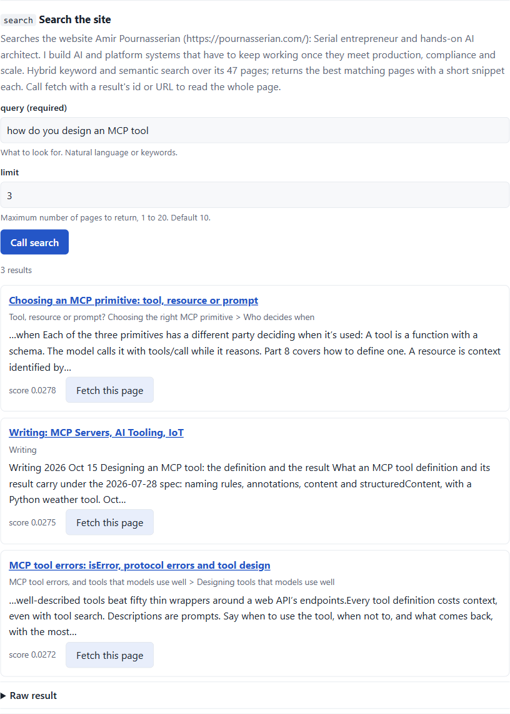

# mcp-my-site

[](https://github.com/pournasserian/mcp-my-site/actions/workflows/ci.yml)
[](LICENSE)
[](https://dotnet.microsoft.com/download)

Point it at your website and ChatGPT, Claude and any other MCP client can search and read it.

A command-line indexer crawls the site and builds a hybrid keyword and vector index. A small
ASP.NET Core app serves that index as an MCP server with `search` and `fetch` tools, and as a JSON
search API for the site's own search box. One site per server, built for sites under 1,000 pages.

## Try it now

A live instance indexes [pournasserian.com](https://pournasserian.com):

| | |
|---|---|
| MCP endpoint | `https://ai.pournasserian.com/mcp` |
| Playground, an MCP client in the browser | <https://ai.pournasserian.com/playground> |
| Search API | <https://ai.pournasserian.com/api/search?q=mcp%20caching> |
| API reference | <https://ai.pournasserian.com/docs> |

```bash
claude mcp add --transport http pournasserian https://ai.pournasserian.com/mcp
```

Then ask Claude Code something about the site. For ChatGPT, add the endpoint as a connector; the
tools follow the `search` and `fetch` contract its connectors expect.



## Quick start

You need the [.NET 10 SDK](https://dotnet.microsoft.com/download). Nothing else: the first index is
keyword-only, so no API key is involved.

```bash
dotnet tool install --global mcpmysite
mcpmysite init https://example.com --keyword-only   # writes appsettings.json
mcpmysite build                                     # crawls the site into ./index
mcpmysite search "how can I contact you"            # checks the index
docker run --rm -p 5000:8080 -v "$PWD/index:/index:ro" -e Index__Path=/index ghcr.io/pournasserian/mcp-my-site:latest
```

Without Docker, clone the repository and run the server from source with
`Index__Path=index dotnet run --project src/McpMySite.Server` from the clone, or publish it
([user guide](docs/user-guide.md#3-installation)). The indexer also runs from a clone as
`dotnet run --project src/McpMySite.Indexer -- ...`, which is how to try unreleased changes.

The server is now at `http://localhost:5000`: `/mcp` for agents, `/playground` to try it in the
browser, `/api/search?q=contact` for JSON, `/healthz` for the loaded index.

```bash
claude mcp add --transport http mysite http://localhost:5000/mcp
```

**Upgrade to hybrid search.** Keyword search matches words; hybrid search also matches meaning, and
is what the live instance runs. It needs an API key for an OpenAI-compatible embeddings endpoint,
OpenRouter by default or [another provider](docs/user-guide.md#53-other-providers); the key is read
from `AI_API_KEY` and never written to a file. A small site embeds for a fraction of a cent.

```bash
export AI_API_KEY=sk-...
# in appsettings.json, under Embeddings, change "Enabled": false to true, then rebuild and serve
mcpmysite build
docker run --rm -p 5000:8080 -v "$PWD/index:/index:ro" -e Index__Path=/index -e AI_API_KEY ghcr.io/pournasserian/mcp-my-site:latest
```

Windows PowerShell and `cmd`, Docker without .NET on the host, and other MCP clients (VS Code,
Cursor, Claude Desktop) are in the [user guide](docs/user-guide.md#4-quick-start).

## Features

- **Hybrid search.** BM25 keyword search and vector search over embeddings, fused per query, with a
  keyword-only fallback when the embedding provider is unavailable.
- **Works without a key.** A keyword-only index needs no embeddings provider at all; switch to
  hybrid search later with one setting and a rebuild.
- **ChatGPT and Claude ready.** Streamable HTTP MCP endpoint with `search` and `fetch` tools in the
  shape ChatGPT connectors use, and server instructions generated from the site itself. Works with
  Claude Code, Claude Desktop, VS Code, Cursor and the MCP Inspector.
- **Search API for your own site.** `GET /api/search` with CORS, rate limiting, offset paging, an
  OpenAPI 3.1 document and an interactive reference. Drop-in snippet for a search box in the
  [user guide](docs/user-guide.md#9-adding-a-search-box-to-your-site).
- **Playground.** `/playground` is a small MCP client in the page, so anyone can try the server
  without installing anything.
- **Docker image.** `docker pull ghcr.io/pournasserian/mcp-my-site:latest`; mount the index or
  point it at a URL.
- **Hot swap.** The server polls the index source and swaps in a new build without a restart.
- **Telemetry.** OpenTelemetry traces, metrics and logs to Application Insights or any OTLP
  collector. Query text is not logged unless you turn it on.
- **Any embeddings provider.** OpenRouter by default; any OpenAI-compatible endpoint works.

## Documentation

- [User guide](docs/user-guide.md): installation, every setting, connecting clients, deployment,
  troubleshooting, FAQ.
- [Architecture](docs/architecture.md): how the indexer, the index format and the server fit
  together.
- [Changelog](CHANGELOG.md) and [contributing](CONTRIBUTING.md).

## Repository

| Path | What |
|---|---|
| `src/McpMySite.Core` | Index model and manifest, JSON and SQLite stores, hybrid search, embedding client |
| `src/McpMySite.Indexer` | The `mcpmysite` CLI: crawl, extract, chunk, embed, write |
| `src/McpMySite.Server` | ASP.NET Core app: MCP endpoint, search API, index loading, telemetry |
| `tests/McpMySite.Tests` | Unit and integration tests |

```bash
dotnet build
dotnet test
```

Questions and ideas go to [Discussions](https://github.com/pournasserian/mcp-my-site/discussions);
bugs to [Issues](https://github.com/pournasserian/mcp-my-site/issues). Changes land on `master`
through pull requests only. MIT licence.
