# mcp-my-site architecture

How the pieces fit, why they are shaped this way, and where to change things. Written for someone
about to work on the code; the [user guide](user-guide.md) covers how to run it.

Diagrams are Mermaid and render on GitHub.

## Contents

1. [High-level view](#1-high-level-view)
2. [Projects and dependencies](#2-projects-and-dependencies)
3. [Core: the index and search](#3-core-the-index-and-search)
4. [Indexer](#4-indexer)
5. [Server](#5-server)
6. [Index format and compatibility](#6-index-format-and-compatibility)
7. [Cross-cutting concerns](#7-cross-cutting-concerns)
8. [Design decisions](#8-design-decisions)
9. [Extension points](#9-extension-points)
10. [Testing](#10-testing)
11. [Repository layout](#11-repository-layout)

---

## 1. High-level view

Two deployables share one artefact. The **indexer** is a CLI that runs offline or in CI and produces
an **index** folder. The **server** is an ASP.NET Core app that loads that folder and answers MCP
clients and HTTP search requests. Both talk to an OpenAI-compatible embeddings endpoint, unless the
index was built keyword-only (`Embeddings:Enabled` false), in which case neither does; nothing else is
shared at run time, and the two never talk to each other.

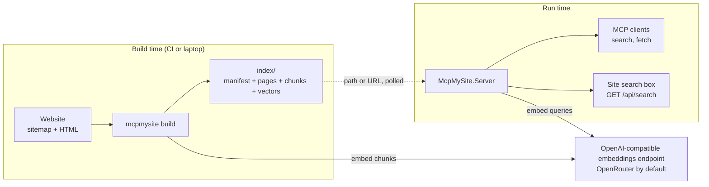

Key properties:

- **The index is the contract.** Indexer and server only agree on the files in the index folder and
  the manifest that describes them. Either side can be replaced or redeployed independently.
- **Full rebuild, hot reload.** Every indexer run rebuilds everything; the server notices a new
  manifest and swaps the index in place without a restart.
- **Hybrid search lives in the store.** Keyword ranking, vector ranking and merging are implemented
  inside each store so the server is agnostic to how data is laid out.
- **Stateless serving.** MCP runs in stateless Streamable HTTP mode and the server keeps no per-client
  state, so any number of instances can serve the same index.

## 2. Projects and dependencies

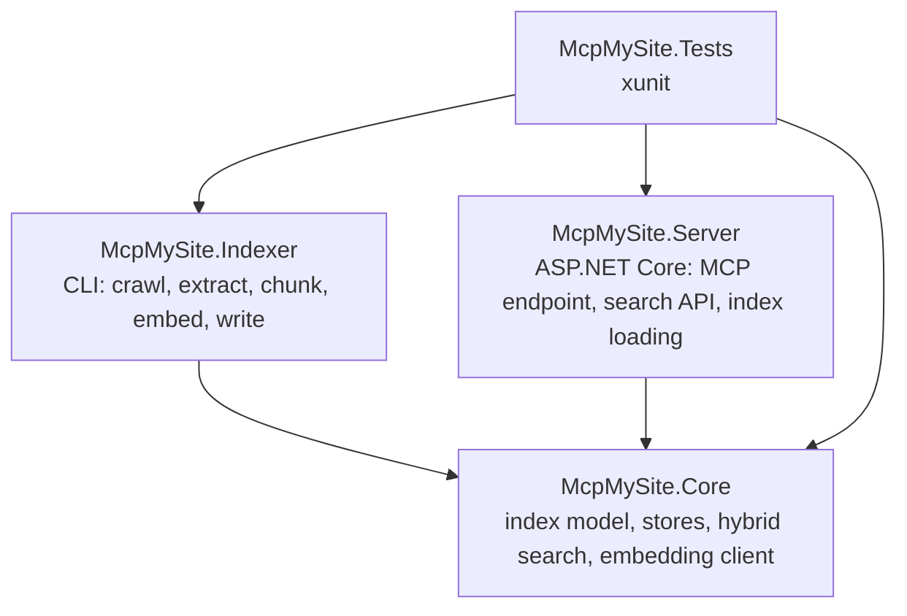

| Project | Role | Notable packages |
|---|---|---|
| `McpMySite.Core` | Everything both apps need: manifest, page and chunk records, `IIndexStore`/`IIndexWriter`, the JSON and SQLite stores, BM25, vector maths, rank fusion, snippets, the embedding generator factory | Microsoft.Extensions.AI (+ .OpenAI), OpenAI, Microsoft.Data.Sqlite |
| `McpMySite.Indexer` | The `mcpmysite` tool. Owns sources, extraction, chunking, the embedding cache, safety checks and the run report | AngleSharp (HTML), ReverseMarkdown (HTML to Markdown), System.CommandLine, Microsoft.Extensions.Hosting (configuration and logging), OpenTelemetry (+ OTLP and Azure Monitor exporters) |
| `McpMySite.Server` | Hosts the MCP server and the search API, loads and refreshes the index, rate limits, exports telemetry | ModelContextProtocol.AspNetCore, Microsoft.AspNetCore.OpenApi, Scalar.AspNetCore (API reference page), OpenTelemetry (+ Azure Monitor exporter) |
| `McpMySite.Tests` | Unit tests, store contract tests, the web app booted in-process | xunit, Microsoft.AspNetCore.Mvc.Testing |

Core has no dependency on ASP.NET Core, Azure or the crawler libraries, so a future store or
provider package can reference it cheaply.

## 3. Core: the index and search

### 3.1 Data model

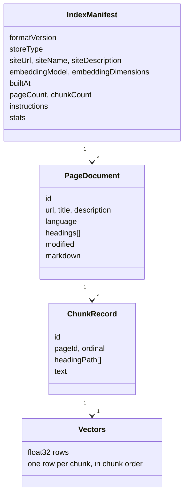

A **page** is stored once as Markdown with its metadata. A **chunk** is a heading-aware slice of a
page; it is the unit that is embedded, keyword-indexed and ranked. The text actually embedded is
`title > heading path` followed by the chunk body, so headings carry meaning into the vector without
being stored twice. Vectors are a flat row-major array in chunk order.

### 3.2 Store abstraction

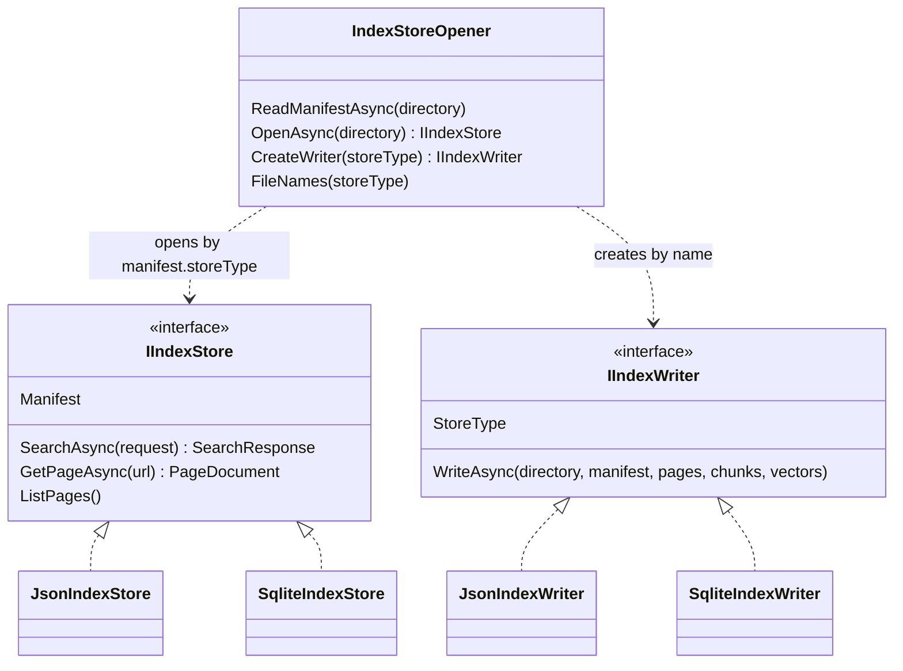

`IndexStoreOpener` is the only place that knows which concrete store exists. It reads the manifest,
dispatches on `storeType`, and tells the server which file names make up an index of that type (so
the URL loader knows what to download).

The two stores differ only in storage:

| | JSON store | SQLite store |
|---|---|---|
| Load | Deserialises pages and chunks, reads `vectors.bin`, builds an in-memory BM25 index | Opens the database read-only, reads all vectors into memory |
| Keyword | In-memory BM25 over `title > path + text` | FTS5 table of the same text, `bm25()` ordering |
| Vector | Brute-force cosine over the flat array | Same, over vectors loaded at open |
| Page lookup | Dictionary keyed by normalised URL | Indexed `url_key` column |
| Concurrency | Immutable after load, lock-free | Single connection guarded by a semaphore |

### 3.3 The search pipeline

Both stores run the same steps; the shared parts live in `McpMySite.Core.Search`.

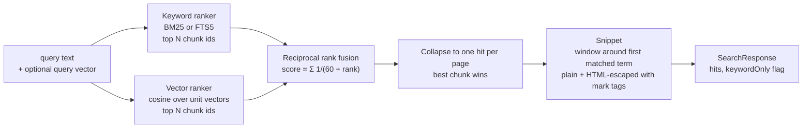

Why this shape:

- **Reciprocal rank fusion** needs no score calibration between BM25 and cosine, which have
  incomparable scales. Each list contributes rank positions only.
- **One hit per page** matches what callers do with results: open a page. The winning chunk still
  supplies the snippet and the heading path, so the hit says where on the page the match is.
- **Query vector is optional.** When the caller cannot embed the query, the vector list is empty and
  fusion degrades gracefully to keyword ranking. The response says so (`keywordOnly`). A keyword-only
  index (manifest `keywordOnly: true`, no model, zero dimensions, empty vector data) takes the same
  path for every query, and the server never embeds against it.
- **Vectors are normalised at load** so cosine is a dot product. At this scale (tens of thousands of
  chunks at most) brute force is a few milliseconds and needs no index structure.

### 3.4 Embedding client

`EmbeddingGeneratorFactory` wraps the OpenAI SDK client as a Microsoft.Extensions.AI
`IEmbeddingGenerator`, pointed at any base URL, with the requested dimensions pinned through
`EmbeddingGenerationOptions`. The key comes from a named environment variable or a direct option.
Both apps use this one factory; the server passes the model and dimensions from the manifest so
queries are embedded exactly like the content was.

## 4. Indexer

### 4.1 Pipeline

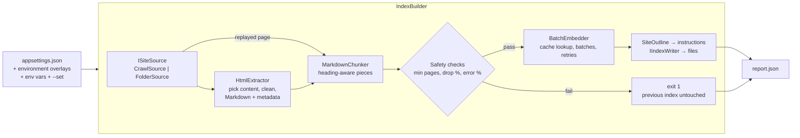

The builder is deliberately linear: read every page, extract and chunk as they arrive, check the
totals, then embed and write. Embedding happens after the safety checks so a broken crawl never
spends money. A page the crawler replays from the page store (below) arrives already extracted and
skips `HtmlExtractor`; chunking still runs so chunk and page ids stay sequential for the build.

### 4.2 Build sequence

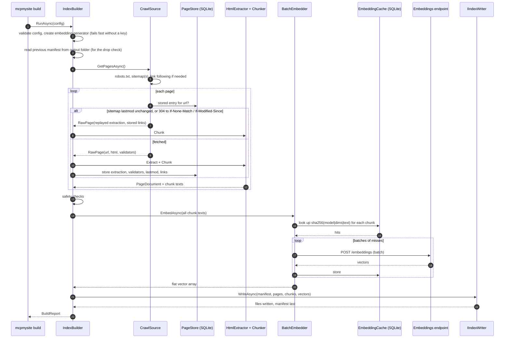

### 4.3 Crawling

`CrawlSource` is a small producer/consumer:

- A queue of URLs is seeded from the sitemap (and the home page when links are followed).
- A coordinator keeps up to `Concurrency` fetches in flight. Each fetch validates the response
  (HTML only, size cap, `X-Robots-Tag`), optionally extracts links into the queue, and pushes the page
  into a channel the builder reads from.
- Before a fetch, the `PageStore` (a SQLite table next to the embedding cache, keyed by site and
  normalised URL) is consulted. An unchanged sitemap `lastmod` skips the request; otherwise the stored
  `ETag` and `Last-Modified` go out as `If-None-Match` and `If-Modified-Since`, and a `304` replays
  the stored extraction and links. Entries older than `FullRefreshDays` are ignored so a change the
  server does not signal is still picked up. The builder writes the entry after extraction, dropped
  pages included.
- Robots rules are checked when a URL is dequeued; include/exclude globs and the same-host rule are
  applied when a URL is normalised, before it ever enters the queue.
- The crawl stops when the queue is empty and nothing is in flight, or when `MaxPages` is reached.

`FolderSource` is the trivial alternative: enumerate HTML files and map paths to URLs.

### 4.4 Content selection

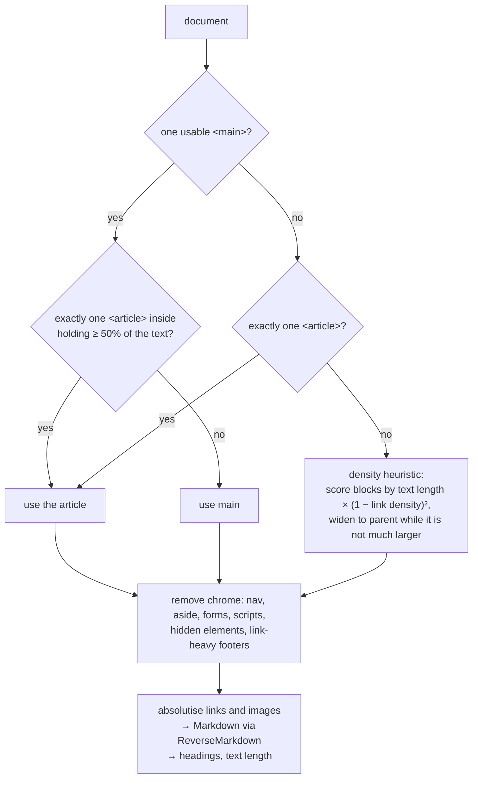

There are no per-site selectors by design. The report records which branch each page took so a site
owner can fix markup rather than configuration.

### 4.5 Chunking

The chunker walks Markdown line by line, keeping a heading stack. Each heading opens a section whose
path is the stack at that point. Fenced code blocks are atomic. Oversized sections split at paragraph
boundaries, then sentence ends, then by length; undersized pieces merge forward (or backward at the
end). The output is a list of `(headingPath, text)` pieces that the builder turns into `ChunkRecord`s
and embedding texts.

### 4.6 Safety and reporting

Three checks guard publishing: a minimum page count, a maximum drop against the previous manifest in
the output folder, and a maximum error share. They run before embedding and writing, so a failing run
costs nothing and changes nothing except `report.json`, which is always written. The report also lists
low-text pages and the content-selection strategy per page; it is the diagnostic surface for site owners.

## 5. Server

### 5.1 Components

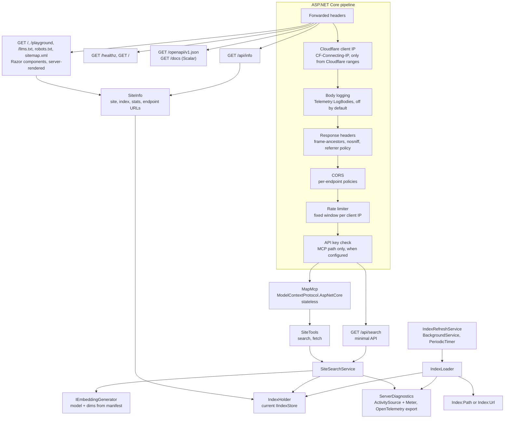

| Component | Responsibility |
|---|---|
| `IndexHolder` | Holds the current store. `Swap` publishes a new one atomically and disposes the old one after a grace period. Records the last load error for `/healthz`. |
| `IndexLoader` | Reads the manifest from path or URL, decides whether it is newer, downloads files (URL case), opens and validates the store, swaps. Never removes a working index on failure. |
| `IndexRefreshService` | Loads once at startup and then on a timer. |
| `SiteSearchService` | The single search path: embed query (with fallback), call the store, emit metrics and spans. Caches the embedding generator per (model, dimensions). |
| `SiteTools` | The two MCP tools. Thin: validate arguments, call the service, shape the result, turn "no index" into a tool error. |
| `ServerCard` | The SEP-2127 server card at `{Mcp:Path}/server-card`: registry name, version, repository and the one remote endpoint with its protocol versions and, when a key is required, the header to send. Serialized per request, with an `ETag` and `Cache-Control`, open to every origin, and exempt from the API key check. |
| `SearchEndpoints` | The HTTP search endpoint with its validation, status codes and OpenAPI metadata. |
| `OpenApiSetup` | The OpenAPI document (titled after the loaded site, MCP excluded) and the Scalar reference page. |
| `SiteInfo`, `InfoEndpoints` | One model of the site, the loaded index, its build stats and the endpoint URLs, served as `/api/info` and rendered by the landing page. |
| `LlmsTxt` | Builds `/llms.txt` from every page of the loaded store, grouped by the manifest's sections, and caches it per index build and base URL. |
| `PlaygroundPage` | The MCP playground: a server-rendered page whose inline script is a minimal Streamable HTTP client (initialize, tools/list, tools/call), with forms generated from input schemas. It writes server data with `textContent` only. |
| `PageEndpoints`, `LandingPage`, `PageShell` | The landing page as a Razor component rendered on the server through `RazorComponentResult`, plus `robots.txt` and `sitemap.xml`. `PageShell` holds the document head (description, canonical, Open Graph, schema.org) and the inlined styles. |
| `CloudflareClientIpMiddleware` | Behind Cloudflare, replaces the connection's remote address with `CF-Connecting-IP` when the caller is inside `Cloudflare:TrustedNetworks`, and tags the request's Activity with `cloudflare.ray_id`, `cloudflare.country` and `client.address`. A pass-through otherwise. |
| `ResponseHeadersMiddleware` | Sets `Content-Security-Policy: frame-ancestors`, `X-Frame-Options`, `X-Content-Type-Options` and `Referrer-Policy` on every response, before the limiter and the endpoints run, so their answers carry them too. `Ui:FrameAncestors` turns the deny-all policy into an origin list. |
| `HeadSupport` | The `AllowHead` endpoint convention: adds `HEAD` to a `GET` endpoint's method metadata so link checkers and monitors get the headers without a body instead of `405`. Every page and JSON endpoint uses it. |
| `BodyLoggingMiddleware`, `SecretRedactor` | Opt-in (`Telemetry:LogBodies`) logging of `/mcp` and `/api/search` bodies: wraps the request and response streams so bytes are copied, up to 8 KB, as they pass and never held back; allowlisted headers; credentials masked. |
| `ServerDiagnostics`, `TelemetrySetup` | The server's ActivitySource, Meter and instruments; OpenTelemetry registration, the exporter choice and the flush on shutdown. |
| `Program` | Wiring: options, CORS policies bound from options, rate limiter partitioned by IP, API key middleware, request logging, telemetry, endpoints, the startup summary line. |

### 5.2 Startup and hot swap

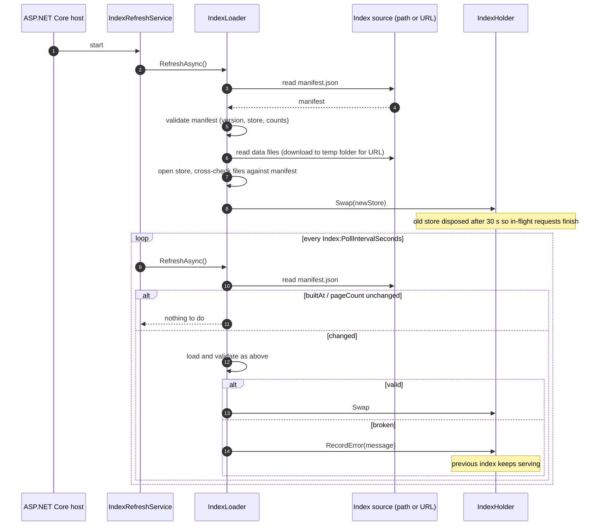

### 5.3 An MCP search call

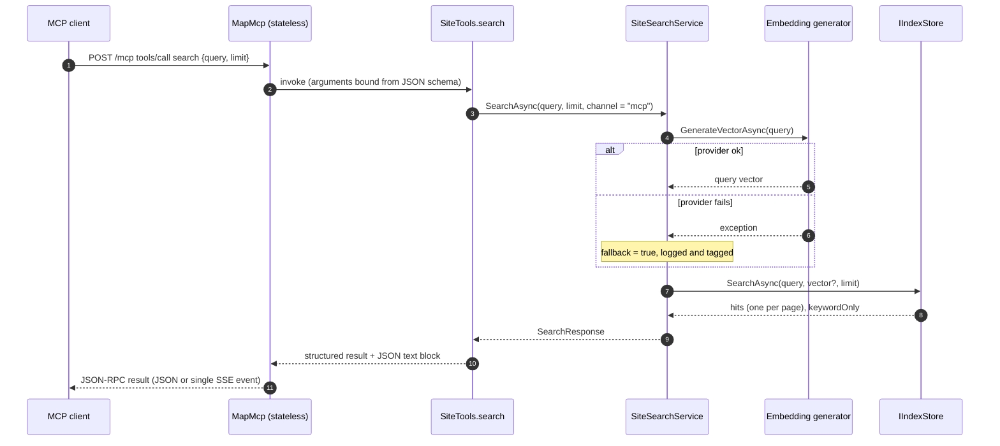

The search API follows the same path from `SearchEndpoints` with `channel = "api"`, adds the
HTML-escaped highlighted snippet, and maps failures to `400`/`503`. `fetch` is simpler: normalise the
URL, look the page up in the store, return its Markdown and metadata, or a tool error.

### 5.4 Request protection

- **Rate limiting** partitions a fixed one-minute window by client IP across MCP and search API.
  `/healthz` is outside the limiter so platform probes never trip it.
- **Forwarded headers** are trusted by default (reverse proxies and platform ingresses set
  them); the setting exists to turn that off when Kestrel is exposed directly.
- **Cloudflare client IP.** Behind Cloudflare the caller is an edge address. After forwarded headers,
  `CloudflareClientIpMiddleware` accepts `CF-Connecting-IP` only when the caller is inside
  `Cloudflare:TrustedNetworks` and writes it to the connection's remote address, so the rate limiter,
  which partitions on that address, needs no change. A request from elsewhere keeps its address and
  its `CF-*` headers are ignored. The ranges prove the request came through Cloudflare, not through
  your zone; restricting the origin to Cloudflare's ranges at the ingress narrows who can reach the
  server at all.
- **Body logging** is a middleware in front of CORS and the limiter, so rejected requests are
  logged too, with whatever body the handler read. It is off unless `Telemetry:LogBodies` is set.
- **Response headers.** `ResponseHeadersMiddleware` runs right after body logging and sets
  `Content-Security-Policy: frame-ancestors 'none'` with `X-Frame-Options: DENY`,
  `X-Content-Type-Options: nosniff` and `Referrer-Policy: strict-origin-when-cross-origin` on every
  response, the limiter's `429` and the transport's answers included. The pages render an API key
  field and buttons that call the tools, so no other site may frame them. `Ui:FrameAncestors`
  lists origins that may; `X-Frame-Options` is then left out because it cannot carry a list.
- **HEAD** is answered by every page and JSON endpoint through the `AllowHead` convention
  (`HeadSupport`), since minimal API routing otherwise matches `HEAD` only against endpoints that
  declare it. Kestrel drops the body. A browser sending `GET` or `HEAD` to `Mcp:Path` without
  `text/event-stream` in `Accept` is redirected to `/` while `Ui:Enabled` is on.
- **API key** is a tiny middleware on the MCP path only, comparing in constant time. The search API is
  intentionally keyless because it is called from browsers.
- **CORS** policies always exist and are bound from options at run time; an empty origin list simply
  allows no browser origin.

### 5.5 Hosting

The server is one stateless container. It needs the index (a URL or a folder), an embeddings endpoint
and a secret key, and it listens on a single HTTP port.

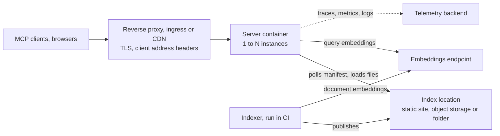

- **Nothing platform-specific in the image.** Settings are environment variables, the key is read from
  the environment, and the only probe path is `/healthz`.
- **Never scale to zero.** One instance should always run: a cold start has to load the index first, and
  an agent would meet that as a slow or failed MCP call.
- **A proxy is expected.** The server speaks HTTP and takes the visitor's address from forwarded
  headers (section 5.4). Behind Cloudflare it also reads `CF-Connecting-IP`, but only from Cloudflare's
  ranges.
- **The index travels separately.** Publishing a new index never restarts the server; it polls the
  manifest and swaps the new one in.

## 6. Index format and compatibility

The manifest is the contract between indexer and server.

| Rule | Why |
|---|---|
| `formatVersion` is bumped on any incompatible change to the files; the server accepts the current and the previous version | Lets an index built by the previous indexer keep serving during a rolling upgrade |
| New manifest fields are optional and do not bump the version (`siteDescription` and `stats` came this way) | Older servers ignore fields they do not know, and newer servers treat a missing field as absent |
| The manifest is written last; SQLite is written to a temp file and renamed | A reader (or the poller) never sees a manifest that points at half-written data |
| Data files are cross-checked against the manifest on load (vector length, page and chunk counts) | A partial upload is detected and rejected instead of serving wrong results |
| The manifest records the embedding model and dimensions | The server embeds queries identically; switching models is an index rebuild, not a server change |
| Zero-page manifests are invalid | An empty build can never replace a good index, even if it slipped past the indexer's checks |

Adding a store type means adding its file list to `IndexStoreOpener.FileNames` so the URL loader
knows what to fetch.

## 7. Cross-cutting concerns

**Configuration.** Both apps use the standard .NET layering: `appsettings.json`,
`appsettings.{Environment}.json`, user secrets in Development, environment variables (`Section__Key`),
and for the indexer explicit `--set Section:Key=Value` overrides plus a few convenience flags. Under
all of these the indexer loads `appsettings.defaults.json`, shipped next to the tool with every
setting and its default, so a site's own file only needs what differs. The indexer resolves relative paths against the folder that holds its config file, so a site repository
can carry its indexer settings next to the site.

**Secrets.** Only the embeddings key (and the optional MCP API key) are secret. Both are read from
configuration or a named environment variable and never written to the index, the report or logs.

**Telemetry.** The server emits an `ActivitySource` and a `Meter`, both named `McpMySite.Server`
(`ServerDiagnostics`), and the indexer the same pair named `McpMySite.Indexer` (`IndexerDiagnostics`).
The server tags every search with its channel (`mcp` or `api`) and whether it fell back to keyword
search, traces index loads, counts rejected requests and publishes the index age as a gauge; the
indexer traces a build in its collect, embed and write stages and records the run's page outcomes.
Both also collect the embedding client's GenAI spans, and the server the MCP SDK's. Logging is
standard `Microsoft.Extensions.Logging` to the console, formatted by `Logging:Console`. Export is
OpenTelemetry, chosen by `Telemetry:Exporter` and resolved in Core (`TelemetryExport`) so both programs
read the same settings the same way: Azure Monitor when its connection string is present, otherwise
OTLP when an endpoint is configured, unless set explicitly. Both flush exporters before their
container is disposed, because the exporters' HTTP clients come from it. Query text is excluded unless
explicitly enabled. Behind Cloudflare each request span also carries the Ray ID, the visitor's country
and client address, so a row in Application Insights joins the Cloudflare dashboards by Ray ID;
`Telemetry:LogBodies` adds opt-in request and response bodies, capped and redacted.

**Error philosophy.** Build time fails closed: any doubt about the crawl stops the publish. Query
time fails open: a missing embedding degrades to keyword search rather than an error, and a bad new
index leaves the old one serving. Both failure modes are observable (exit code and report; health
endpoint and metrics).

## 8. Design decisions

| Decision | Alternatives considered | Why this one |
|---|---|---|
| Stateless MCP transport, tools only | Stateful sessions with resources and prompts | Horizontal scaling without affinity; the two tools cover the use case; matches the 2026 protocol direction |
| Each store implements the whole search | A generic search layer over a storage interface | Lets a database store use its own full-text engine (FTS5 today, others later) instead of pulling everything into memory |
| Reciprocal rank fusion | Weighted score blending | No calibration between BM25 and cosine scales; robust defaults; easy to reason about |
| Brute-force vector search | HNSW or an external vector database | Sites this size have thousands of chunks, not millions; zero extra infrastructure |
| Query embedding driven by the manifest | Configure model on the server | Removes a whole class of mismatch bugs; model changes are index rebuilds |
| Automatic content selection, no selectors | Per-site CSS selector overrides | Nothing to maintain or break on redesigns; the report shows what was picked |
| Full rebuild with an embedding cache | Incremental crawl with change detection | Deleted pages vanish for free; the cache removes most of the cost of a full rebuild |
| Markdown as the stored format | HTML, plain text | Readable by models and humans, keeps structure, small |
| Trust `CF-Connecting-IP` only from Cloudflare ranges | Trust it always, or trust only `X-Forwarded-For` | Anyone can send the header, and behind a proxy every visitor would otherwise share one address |
| Chunks carry title and heading path | Bare text chunks | Headings disambiguate short sections and improve recall on section-level questions |
| Per-IP fixed-window rate limit built in | Rely on a gateway | Works everywhere the container runs; a gateway can still sit in front |
| Fail closed on build, fail open on query | Fail open everywhere, or fail closed everywhere | A broken index is worse than a stale one; a degraded answer is better than no answer |
| Landing page rendered on the server with Razor components | A static page that fetches `/api/info`; a JavaScript framework | Crawlers and link previews see the full content; Razor encodes crawled titles and descriptions; no front-end build; ships in the shared framework |
| Build stats in the manifest | Server reads `report.json` | Works the same for `Index:Url` and `Index:Path`; the report stays an owner's diagnostic file |

## 9. Extension points

- **New index store** (for example Postgres or a hosted search service): implement `IIndexStore` and
  `IIndexWriter` in Core or a separate package, register the type name in `IndexStoreOpener`
  (`OpenAsync`, `CreateWriter`, `FileNames`), and add it to the store contract tests, which run every
  behaviour test against every store.
- **New content source**: implement `ISiteSource` (an async stream of raw pages plus an error list)
  and add a `SourceType`. Extraction and everything downstream is unchanged.
- **New embedding provider**: anything OpenAI-compatible is configuration only. A different protocol
  means another `IEmbeddingGenerator` implementation behind `EmbeddingGeneratorFactory`.
- **V2 chat API**: a new endpoint group in the server that uses `SiteSearchService` as its retrieval
  tool; the index and search layers need no change.
- **Scale profile**: the spec's three seams map to code boundaries: store (`IIndexStore`), model
  provider (`EmbeddingGeneratorFactory`), edge (rate limiter and API key middleware, replaceable by
  an API gateway). Platform-specific implementations would ship as separate packages referencing Core.

## 10. Testing

| Layer | What is tested | How |
|---|---|---|
| Search primitives | Tokenizer, BM25 ordering, vector maths, rank fusion, snippets, URL keys, manifest validation | Plain unit tests |
| Stores | Write then reopen, hybrid ranking, vector-only matches, keyword-only mode, page lookup tolerance, corrupt file rejection, FTS injection safety | One theory per behaviour, run against both store types |
| Indexer | Content selection branches, metadata resolution, title suffix stripping, chunk paths and splitting, globs, robots.txt parsing, folder URL mapping, crawl URL normalisation and link extraction, site outline, configuration layering | Unit tests with inline HTML and Markdown fixtures |
| Server | Health, search API (including CORS and validation), MCP tool listing, `search` then `fetch` round trip, tool errors, instructions from the manifest, API key enforcement, loader hot swap and URL loading, client IP resolution behind Cloudflare, body logging with its cap, redaction and streaming | The real app booted in-process with `WebApplicationFactory`; a throwaway static-file host for the URL loader |

Deliberately not covered by automated tests: live crawling of a real site and the embedding provider.
The manual check is the `mcpmysite search` command against a freshly built index, plus
`report.json`.

## 11. Repository layout

```
Directory.Build.props              shared build settings (net10.0, nullable, version)
McpMySite.slnx
src/
  McpMySite.Core/
    IndexFormat.cs                 version, file names, store type names
    Model/                         IndexManifest, PageDocument, ChunkRecord, search request/response
    Search/                        Tokenizer, Bm25Index, VectorMath, HybridRanker, Snippets
    Stores/                        IIndexStore, IIndexWriter, IndexStoreOpener, UrlKey, Json/, Sqlite/
    Embeddings/                    EmbeddingOptions, EmbeddingGeneratorFactory
    Telemetry/                     TelemetryExport (exporter choice shared by both apps)
  McpMySite.Indexer/
    Program.cs                     CLI (build, init, search)
    Configuration/                 IndexerConfig, IndexerConfigLoader, GlobMatcher
    Sources/                       ISiteSource, CrawlSource, FolderSource, RobotsTxt, SitemapReader, PageStore
    Extraction/                    HtmlExtractor, ExtractedPage
    Chunking/                      MarkdownChunker
    Embeddings/                    EmbeddingCache, BatchEmbedder
    Build/                         IndexBuilder, SiteOutline, BuildReport
    Telemetry/                     IndexerDiagnostics, IndexerTelemetry (logging and export setup)
    appsettings.defaults.json      every setting and its default, shipped with the tool
  McpMySite.Server/
    Program.cs                     pipeline and endpoint wiring
    Options/                       strongly typed settings
    Index/                         IndexHolder, IndexLoader, IndexRefreshService
    Search/                        SiteSearchService
    Telemetry/                     ServerDiagnostics, TelemetrySetup
    Requests/                      CloudflareClientIpMiddleware, BodyLoggingMiddleware, SecretRedactor,
                                   ResponseHeadersMiddleware, HeadSupport
    Pages/                         PageEndpoints, LandingPage, PlaygroundPage, PageShell (Razor),
                                   PageAssets (inlined styles and scripts), LlmsTxt
    Mcp/                           SiteTools
    Api/                           SearchEndpoints, InfoEndpoints (SiteInfo, /api/info), OpenApiSetup
    appsettings.json, Dockerfile
tests/
  McpMySite.Tests/                 Core/, Indexer/, Server/, TestIndex (fixture builder), CapturedLogs, FakeCollector
docs/
  user-guide.md, architecture.md
```
